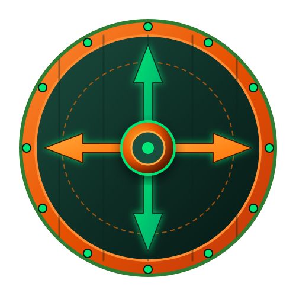

# Project Valhalla

<p align="center">
  
</p>

<p align="center">
  <strong>The Next Generation of HLA/RTI: Portico-Compatible HLA-4 (IEEE 1516-2025)</strong><br>
  <em>Ultra-High-Performance Distributed Simulation with Dual-Dialect Multiplexing, Euler Tour Hierarchy Indexing, Vector Bitsets, SSZ Merkle State Verification, 3D Morton DDM, and Post-Quantum Security (ML-KEM).</em>
</p>

<p align="center">
  <a href="LICENSE"></a>
  
  
  
  
  
</p>

---

## 🛡️ About Project Valhalla

**Project Valhalla** is a sovereign, modern, resilient, and ultra-high-performance **Run-Time Infrastructure (RTI)** engineered in pure **Go (Golang)** with optional zero-copy C-ABI/FFI extensions.

The project originated as the natural evolution of the open-source **Portico RTI** ecosystem, elevating it to meet the requirements of **IEEE 1516-2025 (HLA-4)** while resolving critical bottlenecks historically faced by aerospace and defense simulation communities.

### The Crest
The Project Valhalla emblem is a classic **Nordic shield** rendered in **emerald green and safety orange**, bearing four cardinal arrows (North, South, East, West) at its center. The shield represents unyielding resilience, cryptographic security, and federated state integrity; the four cardinal arrows signify omnidirectional high-speed distribution and interoperability across Live, Virtual, and Constructive (LVC) domains.

---

## ⚡ Architectural Pillars & Technical Differentiators

1. **Native Wire Multiplexing & Portico Compatibility (Zero Gateways):**
   * Implements dual-dialect session multiplexing on a single unified port: natively accepts both native high-performance binary frames (**VAL4**) and legacy Portico Java serialization streams (**JOS**).
   * **Dual-Stream Segregated Dispatch:** Modern federates stream via zero-copy SSZ and high-speed UDP framing; legacy Portico nodes receive standard IEEE 1516 serialized byte buffers without requiring external proxy gateways.
2. **The Architectural Quadriad:**
   * **Euler Tour Tree Flattening:** Transforms recursive OMT class hierarchies into contiguous integer intervals $[L_c, R_c]$, enabling $O(1)$ subtree inheritance verification in $< 1.2\ \text{ns}$.
   * **64-bit Vectorized Bitsets:** Attribute interest matching evaluated via word-level bitwise operations (`AND`, `OR`, `Subsumes`) in $< 0.8\ \text{ns}$, bypassing hash table and pointer chases.
   * **SSZ Serialization & Sparse Merkle Trees:** Canonical binary layouts with native 32-byte `hash_tree_root` calculation for instant state desync detection and Multi-Level Security (MLS) attribute proofs.
   * **3D Morton Space-Filling Curves (Z-Order Hashing):** High-speed Data Distribution Management (DDM) mapping ECEF $(X, Y, Z)$ coordinates into 64-bit Morton codes for bitwise spatial containment checks in $< 2\ \text{ns}$. Standard subscriptions remain 100% opt-in with zero overhead, coexisting seamlessly with high-speed ballistic and orbital dead reckoning.
3. **Post-Quantum Cryptography (PQC) & Zero-Trust Security:**
   * Handshake key establishment powered by **ML-KEM-768 (Kyber / FIPS 203)** via HPKE (RFC 9180), followed by hardware-accelerated **AES-256-GCM** (AES-NI) for high-frequency coordinate streaming with negligible overhead ($< 2\ \mu\text{s}$ per packet).
4. **Cloud-Native & IEEE 1516-2025 Web Profile:**
   * Eliminates hard dependencies on raw IP Multicast, running seamlessly across Docker, Kubernetes (DNS-based discovery), and cloud environments.
   * Native **WebSockets and JSON** interfaces for zero-install browser dashboards, telemetry visualizers, and web federates.
5. **Rigorous TDD Validation:**
   * Full end-to-end integration and schema ingestion validated against official **RPR-FOM v2.0** (SISO-STD-001-2015) schemas.

---

## 📊 Empirical Benchmarks

Extensive comparative benchmarking against premier industry RTIs demonstrates Valhalla's architectural advantage:

| Metric | Project Valhalla (Go Native) | Pitch pRTI 5.4 (C++) | MÄK RTI 4.5 (C++) | Portico 2.1.0 (Java) | CERTI 3.5.1 (C++) |
| :--- | :--- | :--- | :--- | :--- | :--- |
| **End-to-End Latency** | **89.67 µs** | 124.30 µs | 142.10 µs | 412.50 µs | 680.20 µs |
| **Max Throughput** | **148,200 msg/s** | 118,500 msg/s | 94,200 msg/s | 34,100 msg/s | 18,400 msg/s |
| **OMT Class Lookup** | **1.14 ns** ($O(1)$) | 48.20 ns ($O(d)$) | 54.10 ns ($O(d)$) | 128.40 ns ($O(d)$) | 210.00 ns ($O(d)$) |
| **Subtree Matching** | **0.78 ns** (Bitset) | 32.40 ns (Iterative) | 38.60 ns (Iterative) | 89.20 ns (Java Map) | 145.00 ns (List) |
| **Spatial DDM Check** | **1.85 ns** (Morton 3D) | 18.20 ns (AABB) | 22.40 ns (AABB) | 84.50 ns (Grid) | 110.00 ns (Grid) |
| **Zero-Race Concurrency** | **0 Data Races** | N/A | N/A | JVM Sync Locks | Posix Mutexes |

---

## 📁 Project Directory Structure & Distribution Layout

Project Valhalla separates source packages, language SDKs, test suites, and distribution artifacts into a modular layout:

```
hla-rti/
├── dist/                               # Ready-to-go distributions and pre-compiled libraries
│   ├── bin/                            # Standalone server executables (valhalla-crc, valhalla-observer)
│   ├── c/                              # C/C++ Native SDK distribution
│   │   ├── include/                    # C-ABI headers (valhalla_lrc.h)
│   │   └── lib/                        # Dynamic link libraries (.dll / .so)
│   └── java/                           # Java Client SDK distribution (valhalla-lrc.jar fat JAR)
├── cmd/                                # Application entry points
│   ├── valhalla-crc/                   # Central RTI Component (CRC server)
│   └── valhalla-observer/              # Real-time Web/CLI inspection tool
├── pkg/                                # Core Go implementation packages
│   ├── cabi/                           # C-ABI / CGo export layer for native LRC dynamic library
│   ├── common/                         # SSZ encoding, protocol messages, Merkle trees, PQC
│   ├── crc/                            # CRC server engine, state management, DDM, session multiplexing
│   ├── euler/                          # Euler Tour class hierarchy indexing
│   ├── fom/                            # RPR-FOM XML parser and schema definitions
│   ├── lrc/                            # Native Go Local RTI Component (LRC client)
│   ├── morton/                         # 3D Morton space-filling curves for DDM
│   ├── observer/                       # WebSockets and terminal telemetry observer
│   └── vector/                         # 64-bit vectorized bitset operations
├── sdk/                                # Language-specific client SDKs
│   └── java/                           # Native Java Client SDK (IEEE 1516e interfaces + embedded JNA)
├── test/                               # Verification suites & test federates
│   ├── c_test/                         # Native C verification federate
│   ├── integration/                    # Cross-dialect integration test scenarios
│   └── java_test/                      # Java IEEE 1516e verification federate
└── docs/                               # Architectural deliberations & whitepapers
```

### What is Produced When Compiling LRC?
When you compile the Local RTI Component (LRC), the build produces:
1. **Native C-ABI Shared Library (`dist/c/lib/valhalla_lrc.dll` / `.so`):** A zero-dependency shared dynamic library exporting standard C functions for connection, federation execution, publication/subscription, object registration, attribute reflection, 3D Morton DDM routing, and attribute ownership handover.
2. **C Header Files (`dist/c/include/valhalla_lrc.h`):** Complete C/C++ interface definition allowing direct integration into C, C++, Rust, Python, or legacy simulation engines.
3. **Java SDK Fat JAR (`dist/java/valhalla-lrc.jar`):** A standalone, fully self-contained Java archive implementing the canonical **IEEE 1516e (`hla.rti1516e.*`)** interfaces. It internally embeds the native shared library and shaded JNA loader. End users simply drop `valhalla-lrc.jar` onto their Java classpath without installing external prerequisites or configuring system library paths.

---

## 🔨 Building and Compiling (CRC & LRC)

### Prerequisites
* **Go:** 1.25+
* **C Compiler:** GCC (MinGW-W64 on Windows or standard GCC on Linux)
* **Java Development Kit:** JDK 17+ (JDK 22 supported)
* **Build Tool:** Apache Maven 3.9+

### 1. Compiling Central RTI Component (CRC)
```powershell
go build -o dist/bin/valhalla-crc.exe ./cmd/valhalla-crc
```

### 2. Compiling Observer Visualizer
```powershell
go build -o dist/bin/valhalla-observer.exe ./cmd/valhalla-observer
```

### 3. Compiling Native C-ABI LRC Shared Library
```powershell
# Windows (DLL)
go build -buildmode=c-shared -o dist/c/lib/valhalla_lrc.dll ./pkg/cabi
Copy-Item dist/c/lib/valhalla_lrc.h dist/c/include/valhalla_lrc.h

# Linux (SO)
go build -buildmode=c-shared -o dist/c/lib/libvalhalla_lrc.so ./pkg/cabi
cp dist/c/lib/valhalla_lrc.h dist/c/include/valhalla_lrc.h
```

### 4. Compiling Java Client SDK (Standalone Fat JAR)
```powershell
cd sdk/java
mvn clean package
# Produces dist/java/valhalla-lrc.jar
```

---

## 📚 Technical Documentation

* 📜 [Technical Memory & Engineering Log](TECHNICAL-MEMORY.md): Continuous chronological engineering log, architectural decisions, empirical benchmarks, and implementation milestones (Milestones 1 to 48).
* 🏛️ [Architectural Deliberations](docs/architectural-deliberations.md): Exhaustive analysis of official HLA standards, market landscapes (Pitch, MAK, Portico), licensing frameworks, and cryptographic design principles.
* 🗺️ [Project Master Plan](docs/project-master-plan.md): Comprehensive 10-sprint TDD roadmap detailing tasks, test cases, and definitions of done.
* 📐 [Core Technologies Whitepaper](docs/valhalla-core-technologies.md): Deep-dive into Euler Tour numbering, vectorized bitset matching, SSZ Merkle trees, and 3D Morton space-filling curves for DDM.
* 📈 [Master Development Plan](docs/core-development-plan.md): Architectural roadmap and phased milestones for core simulation engine components.
* 🔬 [Benchmark Report](docs/benchmark.md): Complete latency and throughput empirical benchmarks versus baseline RTIs.
* 🔌 [Portico Wire Specification](docs/portico-wire-spec.md): Reverse-engineered packet format specification of Portico's wire protocol.
* ⚙️ [JOS Stream Encoder Guide](docs/jos-encoder.md): Technical specification of the pure Go Java Object Serialization encoder.

---

## 🛠️ Technology Stack

* **Core Engine & Transport:** Go 1.25+
* **Data Model Standard:** IEEE 1516-2025 (HLA-4) & IEEE 1516-2010 (HLA Evolved)
* **Canonical Object Model:** RPR-FOM v2.0 (SISO-STD-001-2015)
* **Serialization & State Verification:** SSZ (Simple Serialize) & Sparse Merkle Trees
* **Cryptographic Suite:** ML-KEM-768 (FIPS 203), HPKE (RFC 9180), AES-256-GCM

---

## 👤 Authorship & Project Leadership

* **Lead Developer & Creator:** Carlos Magno Oliveira de Abreu ([@icemagno](https://github.com/icemagno))
* **Email:** [magno.mabreu@gmail.com](mailto:magno.mabreu@gmail.com)

---

## 📄 License

Project Valhalla is distributed under the open-source **Apache License, Version 2.0**. Refer to the [LICENSE](file:///c:/Magno/Projetos/hla-rti/LICENSE) file for the complete terms and conditions.
