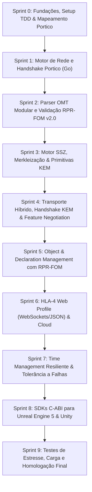

# Plano de Projeto Detalhado: Projeto Valhalla (Evolução PorticoRTI para HLA-4)

> **Projeto:** Projeto Valhalla (Evolução do PorticoRTI para HLA-4)  
> **Autor e Desenvolvedor Principal:** Carlos Magno Oliveira de Abreu (<magno.mabreu@gmail.com>)  
> **Licença:** Apache License, Version 2.0  
> **Linguagem Principal:** Go (Golang) — com extensões em Rust via C-ABI/FFI onde houver necessidade estrita de *zero-copy* ou aceleração SIMD.  
> **Objetivo Primário:** Implementar uma RTI moderna e de alto desempenho baseada na especificação **IEEE 1516-2025 (HLA-4)**, incorporando estruturas criptográficas e de serialização originárias de blockchain (**SSZ / Árvores de Merkle / Provas de Inclusão**), segurança pós-quântica baseada em **KEM (Key Encapsulation Mechanism - ML-KEM / Kyber)**, mantendo **100% de compatibilidade nativa de rede (*wire-compatible*) com a rede PorticoRTI** (sem adaptadores externos ou gateways intermediários), utilizando o **RPR-FOM v2.0** como base estrita de testes.  
> **Objetivo Secundário:** Atender gradualmente às principais carências da comunidade de simulação por ordem crescente de complexidade técnica.  
> **Metodologia:** Test-Driven Development (TDD) estrito, com tarefas iniciais minuciosamente granularizadas e planos de testes executáveis a cada passo.

---

## 1. Diretrizes Técnicas e de Arquitetura

### 1.1. Princípio da Convivência Transparente (Portico Wire-Compatibility)
A compatibilidade com o Portico não será alcançada por meio de uma ponte (*bridge*) ou processo separado, mas sim por **capacidade de transporte polimórfico**:
* O mesmo binário em Go implementará o protocolo de rede original do Portico (mensagens binárias de controle, descoberta e canais de transporte derivados do JGroups / TCP / UDP).
* Existirá um mecanismo de **Negociação de Recursos (*Feature Negotiation*)** no aperto de mão (*handshake*):
  * Se o nó remoto for um Portico legado (Java): o motor fala estritamente o dialeto Portico clássico.
  * Se o nó remoto for outro nó Next-Gen: o canal chaveia automaticamente para o protocolo otimizado de alta velocidade (compressão, canal de Merkle, QUIC/gRPC).
* **Transparência de Payload:** Para o Portico clássico, o payload de atributos é tratado como `byte[]` opaco. O novo motor trafega buffers **SSZ** encapsulados nesse array sem quebrar nós legados.

### 1.2. Estratégia de Linguagem (Go + Rust)
* **Go (Core & Network):** Concorrência nativa com goroutines e channels, excelente suporte a redes assíncronas, facilidade imensa para Docker/Kubernetes (binário estático único sem dependência de JVM), servidores nativos HTTP/2, gRPC e WebSockets.
* **Rust (Módulos de Aceleração Opcionais):** Casos específicos onde a latência de Garbage Collection do Go ou a necessidade de aceleração vetorial (SIMD) para hashing SHA256/Keccak de árvores de Merkle massivas exija alocação manual e *zero-copy* absoluto via FFI / C-Shared.

### 1.3. Hierarquia de Complexidade das Necessidades Secundárias
As demandas da comunidade serão entregues na seguinte ordem de complexidade:
1. **Nível 1 (Baixa):** Serialização ágil e geradores de código (substituição dos Encoding Helpers verbosos pelo SSZ).
2. **Nível 2 (Média-Baixa):** Prontidão para Nuvem e Contêineres (descoberta automática sem dependência de IP Multicast, suporte a K8s/Docker).
3. **Nível 3 (Média):** Perfil Web HLA-4 (WebSockets, JSON e REST API para dashboards e navegadores).
4. **Nível 4 (Média-Alta):** Segurança de Granularidade Fina (MLS / Zero Trust com Merkle Proofs e assinaturas digitais por atributo).
5. **Nível 5 (Alta):** Integração limpa com Game Engines (Unreal Engine 5 e Unity com despacho assíncrono para o Tick/Render Loop).
6. **Nível 6 (Complexa):** Resiliência Temporal (evicção dinâmica de nós lentos no cálculo do LBTS e sincronização suave de *late-joiners*).

---

## 2. Visão Geral das Sprints

---

## 3. Detalhamento Minucioso das Sprints (Orientado a TDD)

---

### SPRINT 0: Fundações, Setup TDD e Mapeamento do Protocolo Portico
> **Objetivo:** Estabelecer o repositório, pipeline de testes rigoroso e desconstruir a especificação binária dos pacotes de rede do Portico a partir do seu código-fonte aberto (Apache 2.0).

#### Tarefas Granulares
* **Tarefa 0.1: Estrutura do Repositório e Ferramental Go**
  * Configurar módulo Go (`go mod init github.com/.../hla-nextgen`).
  * Configurar linters estritos (`golangci-lint`), testes de corrida de concorrência (`go test -race`) e ferramentas de benchmark contínuo.
  * Estruturar diretórios conforme o padrão *Standard Go Project Layout*: `/cmd`, `/pkg/portico`, `/pkg/hla4`, `/pkg/ssz`, `/pkg/omt`, `/test/integration`.
* **Tarefa 0.2: Engenharia do Protocolo de Rede do Portico (Wire Specification)**
  * Mapear o código-fonte Java do Portico (classes `PorticoMessage`, `MessageHelpers`, `Header` e subsistemas de transporte baseados em JGroups e TCP/UDP).
  * Criar o documento formal de especificação interna: `docs/portico-wire-spec.md`, detalhando:
    * Formato do cabeçalho de mensagem (Magic bytes, Message IDs, Flags de compressão, IDs de federação).
    * Sequência binária dos pacotes de ciclo de vida (`SUCCESS_RESP`, `ERROR_RESP`, `CREATE_FEDERATION`, `JOIN_FEDERATION`, `UPDATE_ATTRIBUTES`).
* **Tarefa 0.3: Infraestrutura de Teste Automatizado com Instância Real do Portico**
  * Criar contêiner Docker rodando o Portico Java oficial compilado para servir como nó de validação oracular nos testes de integração.
  * Baixar os esquemas oficiais do **RPR-FOM v2.0** (SISO-STD-001-2015) para o diretório `/test/resources/rpr-fom-v2.0/`.

#### Plano de Testes TDD (Sprint 0)
1. **Teste T0.1 (Ambiente de Integração):** O runner de testes deve iniciar um contêiner com Portico Java, enviar um probe de socket TCP/UDP e receber confirmação de escuta ativa.
2. **Teste T0.2 (Validação de Schemas RPR-FOM):** Teste unitário confirmando a integridade e presença dos 7 módulos XML padrão do RPR-FOM (`Base`, `Physical`, `Warfare`, `Radio`, `SimManagement`, `Logistics`, `SyntheticEnvironment`).

---

### SPRINT 1: Núcleo do Protocolo Portico em Go (Portico Wire Compatibility)
> **Objetivo:** Criar os encoders/decoders binários do Portico em Go e autenticar com sucesso a criação e o ingresso em federações contra um nó Portico Java oficial.

#### Tarefas Granulares
* **Tarefa 1.1: Serializador e Deserializador de Cabeçalhos Portico**
  * Implementar `pkg/portico/wire/header.go`: parser *zero-alloc* dos cabeçalhos binários do Portico (Big-Endian, Magic Number, Message Type int, Sender ID, Target ID).
* **Tarefa 1.2: Modelagem das Mensagens de Ciclo de Vida**
  * Implementar estruturas para:
    * `CreateFederationExecution` (Nome da federação, módulos FOM transmitidos).
    * `DestroyFederationExecution`.
    * `JoinFederationExecution` (Nome do federado, tipo de federado, handles concedidos).
    * `ResignFederationExecution`.
* **Tarefa 1.3: Camada de Conexão e Transporte Portico em Go**
  * Implementar conexão de soquete de controle TCP (`pkg/portico/transport/tcp_client.go`) compatível com o listener padrão do Portico.
  * Implementar loop de leitura de pacotes com buffer circular e despacho assíncrono para goroutines via canais tipados.
* **Tarefa 1.4: Máquina de Estados do Federado (Lifecycle Ambassador)**
  * Implementar estados: `DISCONNECTED`, `CONNECTED`, `JOINED`, `RESIGNED`.

#### Plano de Testes TDD (Sprint 1)
1. **Teste T1.1 (Roundtrip de Serialização):** Criar bytes brutos idênticos aos gerados pelo Portico Java para um pacote `JoinFederationExecution` e validar se o parser Go reconstrói a estrutura com 100% de precisão de campos.
2. **Teste T1.2 (Handshake Real contra Portico Java):**
   * *Ação:* O cliente Go conecta via rede a um executivo Portico Java oficial em execução.
   * *Comando:* Envia requisição para criar federação `"TestFederation"`.
   * *Validação:* O executivo Portico responde com `SUCCESS_RESP`.
   * *Comando:* O cliente Go envia `JoinFederationExecution` para o federado `"GoFederate_01"`.
   * *Validação:* Receber o `FederateHandle` numérico válido atribuído pelo Portico.

---

### SPRINT 2: Parser OMT Modular e Validação com RPR-FOM v2.0
> **Objetivo:** Construir um motor de carregamento e mesclagem de FOMs XML em conformidade com o IEEE 1516-2010 e testar contra toda a árvore de classes do RPR-FOM v2.0.

#### Tarefas Granulares
* **Tarefa 2.1: Modelagem Estrutural do OMT em Go**
  * Definir structs Go para mapeamento do XML: `ObjectClass`, `Attribute`, `InteractionClass`, `Parameter`, `Datatypes` (BasicData, SimpleData, Enumerated, Array, FixedRecord, VariantRecord).
* **Tarefa 2.2: Parser e Resolução de Herança de Módulos (FOM Merger)**
  * Implementar o leitor XML (`pkg/omt/xml_parser.go`).
  * Implementar lógica de herança de classes de objetos: atributos de classes ancestrais (ex: `BaseEntity`) devem ser herdados por subclasses (ex: `PhysicalEntity` -> `Platform` -> `Aircraft`).
  * Lógica de resolução e união de múltiplos módulos XML (*Modular FOM merging*) detectando conflitos de nomes ou handles duplicados.
* **Tarefa 2.3: Ingestão de Schemas RPR-FOM v2.0**
  * Mapeamento completo dos tipos complexos do RPR-FOM: `SpatialFPStruct`, `WorldLocationStruct`, `OrientationStruct`, `VelocityVectorStruct`.

#### Plano de Testes TDD (Sprint 2)
1. **Teste T2.1 (Parsing de Módulo Único):** Carregar `RPR-Base.xml` e verificar se todos os tipos de dados básicos e enumerados foram populados na tabela de símbolos interna.
2. **Teste T2.2 (Resolução de Herança Multi-Módulos):** Carregar `RPR-Base.xml` + `RPR-Physical.xml`. Validar se a classe `Aircraft` possui todos os seus atributos diretos somados aos atributos herdados de `Platform`, `PhysicalEntity` e `BaseEntity`.
3. **Teste T2.3 (Módulo Warfare):** Carregar `RPR-Warfare.xml` e verificar se a interação `WeaponFire` contém parâmetros corretos como `FiringObjectIdentifier`, `EventIdentifier` e `MunitionType`.

---

### SPRINT 3: Motor SSZ (Simple Serialize), Merkleização e Primitivas KEM
> **Objetivo:** Implementar o motor de serialização SSZ, permitindo Merkleização canônica instantânea de tipos complexos do RPR-FOM, geração de provas criptográficas (Merkle Proofs) e o módulo de encapsulamento de chaves pós-quântico (ML-KEM / Kyber).

#### Tarefas Granulares
* **Tarefa 3.1: Implementação das Primitivas SSZ em Go**
  * Implementar regras de codificação canônica do SSZ:
    * Tipos básicos (uint8 a uint256, boolean).
    * Vetores e Contêineres de tamanho fixo.
    * Listas de tamanho variável com tabela de deslocamentos (*offsets*).
* **Tarefa 3.2: Motor de Merkleização (`hash_tree_root`)**
  * Implementar árvore binária de Merkle sobre as estruturas SSZ.
  * Hashing por chunks de 32 bytes utilizando SHA256 (com suporte a fallback otimizado em Go ou wrapper Rust via CGO para aceleração SIMD se benchmarking exigir).
* **Tarefa 3.3: Gerador e Validador de Merkle Proofs e Multiproofs**
  * Implementar geração de caminho de prova (Merkle branch) para um atributo específico contido em um contêiner complexo.
  * Implementar função de verificação: `VerifyMerkleProof(root, leaf, branch, index) bool`.
* **Tarefa 3.4: Adaptador RPR-FOM para Esquemas SSZ**
  * Criar a representação canônica SSZ para os dados de navegação espacial do RPR-FOM (`SpatialFPStruct`: Posição ECEF X/Y/Z, Orientação Psi/Theta/Phi, Velocidade linear).
* **Tarefa 3.5: Módulo Criptográfico Pós-Quântico (ML-KEM / FIPS 203)**
  * Implementar o suporte a KEM Pós-Quântico (**ML-KEM-768 / Kyber**) e o padrão de criptografia híbrida **HPKE (RFC 9180)** em `pkg/crypto/kem.go`.
  * Geração de pares de chaves efêmeras, encapsulamento e desencapsulamento gerando chaves simétricas de 256 bits (AES-256-GCM).

#### Plano de Testes TDD (Sprint 3)
1. **Teste T3.1 (Canonicidade Estrita do SSZ):** Serializar duas instâncias idênticas de `SpatialFPStruct` e garantir que geram exatamente os mesmos bytes binários sem variação de padding.
2. **Teste T3.2 (Verificação de Raiz de Merkle):**
   * *Ação:* Alterar 1 bit da coordenada Z de altitude de uma aeronave.
   * *Validação:* O `hash_tree_root` resultante deve mudar completamente (efeito avalanche).
3. **Teste T3.3 (Prova de Inclusão / Zero-Trust MLS):**
   * *Cenário:* Um objeto `Aircraft` possui atributos [Posição, Velocidade, FrequênciaRadarSecreta].
   * *Ação:* Gerar prova de inclusão apenas para o atributo `Posição`.
   * *Validação:* Um federado receptor que possui apenas a raiz de Merkle global valida matematicamente que a `Posição` é verídica sem receber os bytes da `FrequênciaRadarSecreta`.
4. **Teste T3.4 (Ciclo de Vida do ML-KEM):**
   * *Ação:* Gerar par de chaves ML-KEM-768; o emissor encapsula o segredo; o receptor desencapsula o texto cifrado.
   * *Validação:* Ambas as pontas derivam exatamente o mesmo segredo compartilhado de 256 bits em menos de 50 microssegundos.
5. **Teste T3.5 (Benchmark comparativo):** Benchmark de tempo de codificação/decodificação SSZ vs IEEE 1516 Encoding Helpers convencionais (meta: SSZ no mínimo 3x mais rápido e com zero alocações na leitura).

---

### SPRINT 4: Protocolo Híbrido Otimizado, Handshake KEM e Negociação de Recursos (*Feature Negotiation*)
> **Objetivo:** Implementar o canal de rede de alta performance com negociação automática (Portico vs Next-Gen), integrando o aperto de mão KEM e a cifragem autenticada (AEAD) por atributo sem perda de taxa de transmissão.

#### Tarefas Granulares
* **Tarefa 4.1: Extensão de Handshake com Metadados de Capacidade e KEM**
  * Definir o pacote de handshake estendido: durante o `JoinFederationExecution`, enviar no campo de dados adicionais a assinatura de capacidades: `HLA-EXT-V1 { Capabilities: [SSZ, MERKLE_SYNC, PQC_KEM_KYBER, FAST_UDP] }`.
  * Caso ambos os nós suportem KEM, executar a troca de chaves efêmeras para estabelecer a sessão segura autenticada.
* **Tarefa 4.2: Tabela de Roteamento de Pares e Cifragem Simétrica AEAD (AES-NI)**
  * A RTI mantém um diretório em memória de cada federado conectado:
    * Se nó remoto = `LEGACY_PORTICO`: enviar payload padrão em texto claro codificado dentro do buffer `byte[]` clássico.
    * Se nó remoto = `MODERN_NEXTGEN`: enviar via socket UDP/QUIC cifrado em tempo real com **AES-256-GCM** acelerado por hardware (AES-NI), com latência inferior a 2 microssegundos.
* **Tarefa 4.3: Transporte de Payload Criptografado sobre Rede Portico (MLS por Atributo)**
  * Permitir que nós modernos cifrem atributos confidenciais individualmente antes de entregá-los ao `AttributeHandleValueMap` do Portico. Nós Portico Java tradicionais atuam como repetidores transparentes de bytes sem falhas e sem acesso ao conteúdo sigiloso.

#### Plano de Testes TDD (Sprint 4)
1. **Teste T4.1 (Topologia Mista em Malha com Nós Legados):**
   * *Configuração:* 3 nós na mesma federação: Nó A (Go Moderno), Nó B (Portico Java oficial), Nó C (Go Moderno).
   * *Ação:* Nó A publica uma atualização de objeto.
   * *Validação:* Nó B (Java) recebe o payload como `byte[]` normal. Nó C (Go) reconhece a flag moderna, extrai o SSZ diretamente e valida a raiz de Merkle do estado.
2. **Teste T4.2 (Handshake Seguro KEM + Streaming AES-256-GCM):**
   * *Ação:* Dois nós modernos realizam o handshake KEM e transmitem 10.000 atualizações a 60 Hz cifradas com AES-GCM.
   * *Validação:* Taxa de transmissão mantida sem engasgos, latência adicional por pacote menor que 0,005 ms e integridade autenticada garantida pelo tag AEAD.
3. **Teste T4.3 (Confidencialidade contra Eavesdropping em Rede Portico):**
   * O Nó Portico Java intercepta o buffer de um atributo restrito transmitido pelo Nó Go A; tentar ler os dados e comprovar que o conteúdo é indecifrável sem a chave KEM do Nó Go C.

---

### SPRINT 5: Serviços Centrais da RTI (Object & Declaration Management com RPR-FOM)
> **Objetivo:** Implementar os serviços de publicação, assinatura, registro de entidades e troca de interações táticas do RPR-FOM v2.0 com validação bidirecional.

#### Tarefas Granulares
* **Tarefa 5.1: Declaration Management**
  * Implementação de `PublishObjectClassAttributes` e `SubscribeObjectClassAttributes`.
  * Implementação de `PublishInteractionClass` e `SubscribeInteractionClass`.
  * Filtros de casamento de assinatura (respeitando a herança de classes do RPR-FOM).
* **Tarefa 5.2: Object Management**
  * Implementação de `RegisterObjectInstance` e `DiscoverObjectInstance`.
  * Implementação de `UpdateAttributeValues` e `ReflectAttributeValues`.
* **Tarefa 5.3: Interações Táticas de Combate (Warfare)**
  * Implementação de `SendInteraction` e `ReceiveInteraction`.
  * Mapeamento dos parâmetros das interações `WeaponFire` e `MunitionDetonation` do RPR-FOM.

#### Plano de Testes TDD (Sprint 5)
1. **Teste T5.1 (Ciclo de Vida de Plataforma Aérea):**
   * Federado 1 (Go) registra uma instância da classe `Aircraft` (RPR-FOM).
   * Federado 2 (Portico Java) descobre o objeto com o handle correto da classe base.
   * Federado 1 atualiza `SpatialFPStruct`. Federado 2 reflete a atualização com coordenadas coincidentes.
2. **Teste T5.2 (Engajamento de Armamento - WeaponFire):**
   * Federado 1 envia interação `WeaponFire` com ID do alvo e tipo de munição.
   * Federado 2 recebe o callback `receiveInteraction` e decodifica todos os parâmetros com precisão integral.

---

### SPRINT 6: HLA-4 Web Profile (WebSockets/JSON) e Cloud-Native (Kubernetes)
> **Objetivo:** Satisfazer os requisitos da norma HLA-4 para clientes web leves (dashboards/navegadores) via WebSockets/JSON e criar os manifestos de prontidão para nuvem.

#### Tarefas Granulares
* **Tarefa 6.1: Servidor WebSocket e API REST da RTI (HLA-4)**
  * Implementar servidor HTTP/2 e WebSocket embutido no processo da RTI (`pkg/hla4/web/`).
  * Endpoints REST para:
    * `/v1/federation` (listar federações ativas, federados conectados e status de sincronização).
    * `/v1/objects` (consultar estado atual de instâncias registradas).
* **Tarefa 6.2: Tradutor Bidirecional JSON <-> SSZ <-> OMT**
  * Mecanismo que converte atualizações de atributos em tempo real recebidas da malha Portico/SSZ em mensagens **JSON padronizadas pelo HLA-4** e as transmite aos navegadores via WebSocket.
* **Tarefa 6.3: Recursos Cloud-Native (Kubernetes)**
  * Remoção completa de dependências de IP Multicast para descoberta interna quando rodando em modo nuvem.
  * Descoberta de pares via **Headless Services do Kubernetes** e DNS interno.
  * Implementação de probes de integridade (`/healthz` - Liveness, Readiness, Startup).

#### Plano de Testes TDD (Sprint 6)
1. **Teste T6.1 (Web Federate Conectando via WebSocket):**
   * Um cliente JavaScript/Node.js simula um Web Federate HLA-4. Conecta via WebSocket ao endpoint `/v1/connect`.
   * Envia requisição de assinatura em formato JSON para a classe `Aircraft`.
   * Um federado Portico Java tradicional move a aeronave na rede local.
   * *Validação:* O cliente WebSocket recebe no navegador o JSON contendo os dados de telemetria em tempo real.
2. **Teste T6.2 (Subida de Contêiner e Healthcheck):** Subida do binário Go em contêiner Docker; validação de resposta HTTP 200 em `/healthz` e resolução dinâmica de nós em rede interna simulada sem multicast.

---

### SPRINT 7: Time Management Resiliente e Tolerância a Falhas
> **Objetivo:** Implementar avanço temporal determinístico (LBTS) com mecanismos de proteção contra travamento da federação por nós lentos ou desconectados (*Fault-Tolerant Time Management*).

#### Tarefas Granulares
* **Tarefa 7.1: Motor Matemático de Time Management (IEEE 1516.1)**
  * Implementação de `TimeAdvanceRequest` (TAR), `TimeAdvanceGrant` (TAG), `EnableTimeRegulation` e `EnableTimeConstrained`.
  * Cálculo em tempo real do LBTS (*Lower Bound on Time Stamp*) considerando o *Lookahead* de cada federado ativo.
* **Tarefa 7.2: Mecanismo de Heartbeat e Evicção Dinâmica de Nós Inoperantes**
  * Protocolo de monitoramento de pulso (*heartbeat*): se um federado regulador de tempo não responder ou não solicitar avanço dentro de um limiar configurável (ex: 2000 ms):
    * Emitir alerta na federação.
    * Remover temporariamente o nó inoperante do cálculo do LBTS, **impedindo o congelamento dos demais simuladores**.
* **Tarefa 7.3: Sincronização Dinâmica de Nós Atrasados (*Late-Joining*)**
  * Serviço que captura um snapshot de estado consistente baseado na raiz de Merkle atual e transmite ao novo federado entrante sem pausar o relógio da federação ativa.

#### Plano de Testes TDD (Sprint 7)
1. **Teste T7.1 (Avanço Temporal Determinístico em Passo Ordenado):** Dois federados avançam o tempo em sincronia com carimbos TSO (*Time-Stamp Order*); garantir que nenhuma mensagem é entregue no passado (*causality error*).
2. **Teste T7.2 (Resiliência contra Queda/Congelamento de Federado):**
   * *Cenário:* 3 federados regulando o tempo. O Federado 3 tem seu processo pausado abruptamente (`SIGSTOP`).
   * *Validação:* O motor detecta a ausência de resposta, isola o Federado 3 do cálculo de avanço e os Federados 1 e 2 continuam recebendo seus *TimeAdvanceGrants* sem travar a simulação.

---

### SPRINT 8: SDKs C-ABI para Game Engines (Unreal Engine 5 & Unity)
> **Objetivo:** Criar a biblioteca C-ABI de alto desempenho que permite acoplar a nova RTI diretamente a projetos de Unreal Engine 5 (C++) e Unity (C#) sem travar a thread de renderização.

#### Tarefas Granulares
* **Tarefa 8.1: Exportação da C-ABI nativa em Go / Rust**
  * Criar `pkg/capi`: funções exportadas via `cgo` (`//export`) ou Rust FFI gerando `libhlarti.so` e `hlarti.dll`.
  * Métodos com convenção C padrão: `RTI_CreateFederation()`, `RTI_JoinFederation()`, `RTI_Tick()`, `RTI_UpdateAttributes()`.
* **Tarefa 8.2: Despacho Assíncrono para Thread de Renderização / Tick**
  * Mecanismo de fila interna com leitura não-bloqueante (*lock-free ring buffer*) para que a engine de jogo colete todas as atualizações acumuladas da rede diretamente durante a chamada do seu evento `Tick()` nativo.
* **Tarefa 8.3: Wrapper C# para Unity e Módulo C++ para Unreal Engine 5**
  * Desenvolver projeto de exemplo em Unreal Engine 5 com um *Actor Component* que consome dados de navegação do RPR-FOM e movimenta um modelo 3D de aeronave.

#### Plano de Testes TDD (Sprint 8)
1. **Teste T8.1 (Integração C-ABI):** Executável em C puro realiza o ciclo completo de conexão, registro e atualização de atributos via chamadas à biblioteca dinâmica gerada.
2. **Teste T8.2 (Estabilidade de FPS em Engine):** Teste de estresse rodando a 60 FPS estáveis recebendo 1.000 atualizações/segundo sem causar engasgos (*stuttering*) na thread principal.

---

### SPRINT 9: Testes de Carga, Estresse e Homologação Final
> **Objetivo:** Submeter a solução integrada a cenários extremos de simulação de combate, validando interoperabilidade estrita com o Portico original e conformidade HLA-4.

#### Tarefas Granulares
* **Tarefa 9.1: Bateria de Carga Massiva (10.000 Entidades Simultâneas)**
  * Simulação de enxames de drones com atualização contínua de coordenadas a 30 Hz.
  * Monitoramento de consumo de memória (alvos: ausência de vazamento de memória e estabilidade absoluta de goroutines).
* **Tarefa 9.2: Teste de Longevidade (Soak Test)**
  * Federação executando ininterruptamente por 24 horas consecutivas trocando dados entre nós Go, nós Portico Java e clientes Web HLA-4.
* **Tarefa 9.3: Documentação Completa e Manuais de Migração**
  * Publicação do guia de migração: *"Como rodar seus simuladores Portico existentes nesta nova RTI sem mudar uma linha de código"*.
  * Documentação da API e guia de integração com Unreal Engine 5.

#### Plano de Testes TDD (Sprint 9)
1. **Teste T9.1 (Zero Desync sob Estresse):** 10.000 entidades calculando física; verificação ao final de 1 milhão de iterações de que as raízes de Merkle dos federados coincidem a cada ciclo de sincronização.
2. **Teste T9.2 (Interoperabilidade Certificada com Portico Oficial):** Executar a suíte de validação formal de federações de teste da Calytrix contra o novo binário.

---

## 4. Matriz de Rastreabilidade e Critérios de Conclusão (Definition of Done)

Para que qualquer tarefa ou sprint seja considerada concluída, os seguintes critérios são mandatórios:
1. **Código com Testes Antes da Implementação:** Nenhuma funcionalidade é escrita sem um teste unitário ou de integração que falhe primeiro (Red-Green-Refactor).
2. **Compatibilidade Garantida com Portico:** Cada funcionalidade de rede deve ser testada contra o contêiner oracular do Portico Java.
3. **Documentação Viva:** Todos os pacotes devem conter documentação em código (`godoc`) e testes de exemplo executáveis (`example_test.go`).
4. **Sem Alocações Desnecessárias:** As rotinas de codificação e decodificação na camada crítica de rede devem passar por testes de benchmark (`testing.B`) comprovando uso mínimo de alocações de heap.
