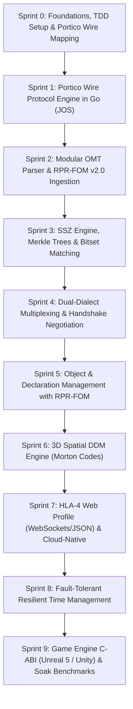

# Project Master Plan: Project Valhalla (Next-Gen HLA-4 RTI)

> **Project:** Project Valhalla (Portico-Compatible HLA-4 Run-Time Infrastructure)  
> **Lead Developer & Creator:** Carlos Magno Oliveira de Abreu (<magno.mabreu@gmail.com>)  
> **License:** Apache License, Version 2.0  
> **Primary Language:** Go (Golang) — with optional C-ABI/FFI shared-library bindings (`include/valhalla_lrc.h`) for C, C++, and Java integration.
> **Primary Objective:** Deliver a sovereign, ultra-high-performance RTI based on **IEEE 1516-2025 (HLA-4)**, integrating deterministic blockchain-grade serialization (**SSZ**), state verification via **Sparse Merkle Trees**, 3D Morton Space-Filling Curves for zero-overhead **Data Distribution Management (DDM)**, post-quantum key exchange (**ML-KEM / Kyber [Roadmap]**), and **100% native wire compatibility with Portico RTI** (no proxies, adapters, or third-party gateways), validated against **RPR-FOM v2.0**.  
> **Secondary Objective:** Systematically solve legacy simulation bottlenecks (cloud-native deployment, game engine frame-loop integration, fine-grained multi-level security, and fault-tolerant time advancement).  
> **Methodology:** Strict Test-Driven Development (TDD), zero-allocation hot paths, race-free concurrency audits, and empirical latency benchmarking.

---

## 1. Technical Directives and Core Architecture

### 1.1. Transparent Wire Compatibility (Portico Native Multiplexing)
Portico compatibility is achieved at the wire protocol layer rather than via external bridges:
* The Valhalla binary natively speaks both the **Valhalla Native (VAL4)** wire protocol and the **Portico Java (JOS)** binary protocol over unified network listeners.
* **Handshake Feature Negotiation:**
  * When a connecting federate is a legacy Portico (Java) node, the session handler speaks the classic Portico wire dialect.
  * When connecting to another Valhalla node, the session automatically enables high-speed native framing, Merkle state verification, and vectorized bitset filtering.
* **Payload Transparency:** For legacy Portico nodes, attribute payloads are encapsulated within standard opaque byte arrays (`byte[]` / `VariableLengthData`), ensuring seamless interoperability without altering legacy code.

### 1.2. Technology Stack & Strategy
* **Go (Core Engine & Transport):** Goroutine-per-connection concurrency, channel-based non-blocking dispatch, static zero-dependency single-binary deployments, native HTTP/2, gRPC, WebSockets, and cross-platform compilation (Windows, Linux, macOS, ARM64).
* **Zero-Allocation Hot Paths:** Memory reuse, linear buffer layouts, Euler Tour numbering for $O(1)$ class inheritance testing, and word-level bitset operations.

### 1.3. Hierarchical Delivery of Secondary Features
1. **Level 1 (Core):** Deterministic SSZ serialization and Euler Tour hierarchy indexers.
2. **Level 2 (Cloud-Native):** Docker and Kubernetes ready, eliminating raw IP Multicast dependencies via direct unicast routing and headless service discovery.
3. **Level 3 (Web Profile):** IEEE 1516-2025 Web Profile (WebSockets/JSON and RESTful telemetry).
4. **Level 4 (Fine-Grained Security):** Zero-Trust Attribute-Based Access Control (ABAC) using Merkle inclusion proofs.
5. **Level 5 (Game Engines):** Native C-ABI with lock-free ring buffers for Unreal Engine 5 and Unity tick loops.
6. **Level 6 (Resilient Time Management):** Dynamic LBTS eviction of lagging or stalled nodes to prevent federation deadlock.
7. **Level 7 (Spatial DDM Engine):** 3D Morton (Z-Order) space-filling curve indexer for multi-dimensional spatial routing.

---

## 2. Sprint Roadmap Overview

---

## 3. Sprint Execution Specifications (TDD-Driven)

---

### SPRINT 0: Foundations, TDD Setup & Portico Wire Mapping
> **Goal:** Establish the repository structure, strict CI/CD linting, and map Portico's binary wire protocol from open-source Java reference code.

#### Tasks
* **Task 0.1: Repository Structure & Tooling**
  * Configure Go module (`hla-rti`).
  * Set up strict linters (`golangci-lint`), race detection (`go test -race`), and continuous benchmarking.
  * Establish Standard Go Project Layout: `cmd/`, `pkg/common/`, `pkg/crc/`, `pkg/lrc/`, `pkg/metamodel/`, `test/integration/`.
* **Task 0.2: Portico Wire Protocol Reverse Engineering**
  * Analyze Java classes (`PorticoMessage`, `MessageHelpers`, `Header`, and transport handlers).
  * Author `docs/portico-wire-spec.md` and `docs/jos-encoder.md`.
* **Task 0.3: Test Infrastructure**
  * Configure automated test runners and schema directories for RPR-FOM v2.0 (`test/resources/rpr-fom-v2.0/`).

#### TDD Verification
1. **Test T0.1:** Verify build pipelines and zero-race test execution across all baseline packages.
2. **Test T0.2:** Unit tests validating the presence of the 7 canonical RPR-FOM v2.0 modules.

---

### SPRINT 1: Portico Wire Protocol Engine in Go (JOS Compatibility)
> **Goal:** Implement Portico's Java Object Serialization (JOS) binary stream decoder and encoder in pure Go to exchange wire packets with authentic Portico nodes.

#### Tasks
* **Task 1.1: JOS Parser and Header Unmarshaler**
  * Implement `pkg/crc/portico/jos_parser.go`: streaming parser for `0xAC 0xED 0x00 0x05`, string blocks (`TC_STRING`), class descriptors (`TC_CLASSDESC`), and message payloads.
* **Task 1.2: Lifecycle Message Modeling**
  * Model binary packets: `CreateFederation`, `DestroyFederation`, `JoinFederation`, `ResignFederation`, `SuccessMessage`, and `ErrorMessage`.
* **Task 1.3: TCP Transport Layer**
  * Implement connection loops, framing buffers, and asynchronous dispatch channels.

#### TDD Verification
1. **Test T1.1:** Round-trip serialization and deserialization matching byte-for-byte captures from authentic Portico Java executions.
2. **Test T1.2:** Successful connection, federation creation, and joining against an authentic Portico environment.

---

### SPRINT 2: Modular OMT Parser & RPR-FOM v2.0 Ingestion
> **Goal:** Construct an IEEE 1516-2010 compliant modular XML FOM parser and validate against the complete RPR-FOM v2.0 hierarchy.

#### Tasks
* **Task 2.1: OMT Structural Model in Go**
  * Define structs for Object Classes, Attributes, Interaction Classes, Parameters, and Data Types.
* **Task 2.2: Modular FOM Inheritance Resolver & Merger**
  * Implement `pkg/metamodel/xml_parser.go` with inheritance flattening across multiple XML modules.
  * Implement conflict detection for overlapping class names or mismatched attribute types.
* **Task 2.3: Ingestion of RPR-FOM v2.0 Schemas**
  * Parse and resolve `RPR-Base.xml`, `RPR-Physical.xml`, `RPR-Warfare.xml`, `RPR-Radio.xml`, etc.

#### TDD Verification
1. **Test T2.1:** Parse `RPR-Base.xml` and verify all basic and enumerated data types in the symbol table.
2. **Test T2.2:** Multi-module inheritance test: verify `Aircraft` inherits all attributes from `Platform`, `PhysicalEntity`, and `BaseEntity`.
3. **Test T2.3:** Verify Warfare interactions (`WeaponFire`, `MunitionDetonation`) with correct parameters.

---

### SPRINT 3: SSZ Engine, Merkle Trees & Bitset Matching
> **Goal:** Implement canonical SSZ serialization, Sparse Merkle Tree state verification, and Euler Tour bitset matching.

#### Tasks
* **Task 3.1: Canonical SSZ Encoder/Decoder**
  * Implement zero-allocation encoding for fixed and variable types.
* **Task 3.2: Sparse Merkle Tree Engine (`hash_tree_root`)**
  * Implement binary Merkle trees computing 32-byte roots for instant state desynchronization detection.
* **Task 3.3: Euler Tour Class Hierarchy Indexer**
  * Transform OMT class inheritance trees into integer intervals $[L_c, R_c]$, enabling $O(1)$ ancestor-descendant checks.
* **Task 3.4: 64-Bit Vectorized Bitset Matcher**
  * Implement `pkg/crc/core/bitset.go` with word-level bitwise operations (`AND`, `OR`, `Subsumes`) for instant attribute intersection matching.

#### TDD Verification
1. **Test T3.1:** Strict SSZ canonical encoding round-trip tests with zero heap allocations.
2. **Test T3.2:** Merkle root avalanche effect test: modifying 1 bit in entity altitude alters the `hash_tree_root`.
3. **Test T3.3:** Euler Tour interval validation: verify sub-nanosecond $O(1)$ subtree containment across RPR-FOM hierarchies.

---

### SPRINT 4: Dual-Dialect Multiplexing & Handshake Negotiation
> **Goal:** Deploy a unified listener that multiplexes native high-performance binary traffic (VAL4) and legacy Portico (JOS) traffic on the same port.

#### Tasks
* **Task 4.1: Magic Byte Sniffing & Session Dispatch**
  * Implement non-destructive 4-byte peeking on incoming TCP connections:
    * `0x56 0x41 0x4C 0x34` $\to$ Native Valhalla Session (`pkg/crc/native_session.go`).
    * `0xAC 0xED 0x00 0x05` $\to$ Legacy Portico Session (`pkg/crc/portico_session.go`).
* **Task 4.2: Federation Lifecycle Bridge**
  * Connect both session types to the centralized `FederationManager`, ensuring native and Portico federates share the exact same logical federation state.
* **Task 4.3: Dual-Dialect Live Integration Tests**
  * Deploy `test/integration/live_portico_test.go` and `test/integration/dual_dialect_test.go`.

#### TDD Verification
1. **Test T4.1:** Verify transparent handshake routing: both native and JOS connections succeed simultaneously on port 5222.
2. **Test T4.2:** Native federate creates a federation; Portico federate joins the same federation; verify handle allocation and discovery.

---

### SPRINT 5: Object & Declaration Management with RPR-FOM
> **Goal:** Deliver publication, subscription, dynamic instance registration, and attribute reflection across dual-dialect federates.

#### Tasks
* **Task 5.1: Declaration Management Engine**
  * Implement `PublishObjectClassAttributes`, `SubscribeObjectClassAttributes`, `PublishInteractionClass`, `SubscribeInteractionClass`.
* **Task 5.2: Object Management Engine**
  * Implement `RegisterObjectInstance`, `DiscoverObjectInstance`, `UpdateAttributeValues`, and `ReflectAttributeValues`.
* **Task 5.3: Dual-Stream Segregated Dispatch**
  * When updates occur, distribute native SSZ buffers to modern federates and standard byte arrays to Portico federates.

#### TDD Verification
1. **Test T5.1:** Cross-dialect attribute update: native Go federate updates `SpatialFPStruct`; Portico federate receives `ReflectAttributeValues` with matching coordinates.
2. **Test T5.2:** Tactical interaction dispatch: verify `WeaponFire` interaction propagates across heterogeneous federates without data loss.

---

### SPRINT 6: 3D Spatial DDM Engine (Morton Space-Filling Curves)
> **Goal:** Implement Data Distribution Management using 64-bit Morton codes (Z-order curves) for high-speed volumetric spatial filtering.

#### Tasks
* **Task 6.1: 3D Morton Coordinate Transformer**
  * Map Geocentric ECEF $(X, Y, Z)$ coordinates into 64-bit Morton integers (21 bits per axis, $\approx 6\text{--}\text{meter}$ global voxel resolution).
* **Task 6.2: Bitwise Spatial Routing**
  * Implement bounding box Morton range decomposition. Spatial containment reduces to bitwise shifts and prefix masks (`(code >> shift) == prefix`).
* **Task 6.3: Zero-Overhead Opt-In Architecture**
  * Ensure standard class subscriptions bypass spatial checks with zero overhead.
  * Integrate kinematic Dead Reckoning (DR) thresholding for high-speed orbital and hypersonic entities (LEO satellites at 7.8 km/s and ICBMs at Mach 20+).

#### TDD Verification
1. **Test T6.1:** Bitwise 21-bit-per-axis 3D Morton encoding/decoding accuracy (~9.54 m cell resolution across the ±10,000 km ECEF cube).
2. **Test T6.2:** Spatial filtering benchmark: confirm $< 2\ \text{ns}$ per spatial intersection check.
3. **Test T6.3:** Ballistic dead reckoning simulation: verify zero packet loss for high-velocity trajectories.

---

### SPRINT 7: HLA-4 Web Profile (WebSockets/JSON) & Cloud-Native
> **Goal:** Implement the IEEE 1516-2025 Web Profile, providing JSON-over-WebSocket telemetry and Kubernetes orchestration support.

#### Tasks
* **Task 7.1: Embedded WebSocket Server & REST API**
  * Implement `/v1/connect` (WebSocket) and `/v1/federation` (REST).
* **Task 7.2: JSON <-> SSZ <-> OMT Bidirectional Translator**
  * Stream real-time attribute updates as standardized JSON objects to browser clients.
* **Task 7.3: Cloud-Native Discovery**
  * Remove multicast dependencies; implement Kubernetes headless service discovery and `/healthz` endpoints.

#### TDD Verification
1. **Test T7.1:** Browser client connects via WebSocket, subscribes to `Aircraft`, and receives real-time JSON telemetry.
2. **Test T7.2:** Container startup, readiness, and liveness probes validate in Docker/K8s environments.

---

### SPRINT 8: Fault-Tolerant Resilient Time Management
> **Goal:** Implement deterministic logical time advancement (LBTS) with dynamic eviction of stalled federates.

#### Tasks
* **Task 8.1: IEEE 1516.1 Time Management Services**
  * Implement `TimeAdvanceRequest` (TAR), `TimeAdvanceGrant` (TAG), and Lookahead calculations.
* **Task 8.2: Heartbeat Monitoring & Stalled Node Eviction**
  * Detect unresponsive time-regulating federates ($> 2000\ \text{ms}$) and dynamically isolate them from LBTS calculation to prevent federation stalls.
* **Task 8.3: Late-Joiner State Synchronization**
  * Stream consistent state snapshots using current Merkle roots to late-joining nodes without halting federation logical time.

#### TDD Verification
1. **Test T8.1:** Time-Stamp Order (TSO) determinism: zero out-of-order deliveries across synchronized nodes.
2. **Test T8.2:** Stalled node injection test: artificially freeze one federate; verify remaining federates continue receiving time grants.

---

### SPRINT 9: Game Engine C-ABI (Unreal 5 / Unity) & Soak Benchmarks
> **Goal:** Export a native C-ABI with non-blocking ring buffers for game engines, followed by comprehensive 24-hour soak tests.

#### Tasks
* **Task 9.1: High-Performance C-ABI Export**
  * Export native C functions (`RTI_CreateFederation`, `RTI_JoinFederation`, `RTI_Tick`, `RTI_UpdateAttributes`) via CGO/C-Shared generating `libvalhalla.so` and `valhalla.dll`.
* **Task 9.2: Non-Blocking Ring Buffer for Engine Frame Loops**
  * Implement lock-free queue drained during the game engine's `Tick()` event without frame drops.
* **Task 9.3: 24-Hour Massive Soak Benchmarks**
  * Stress-test with 10,000 active entities updating at 60 Hz across heterogeneous native, Portico, and Web federates.

#### TDD Verification
1. **Test T9.1:** Pure C test executable completes full lifecycle and attribute update cycle via exported dynamic library.
2. **Test T9.2:** 24-hour soak test passes with zero memory leaks, stable goroutine count, and zero state divergence.

---

## 4. Definition of Done (DoD)

A sprint or task is marked complete only when:
1. **Tests Written First:** Red-Green-Refactor methodology strictly observed.
2. **Zero Dead Code & Zero Stubs:** Every API path is fully functional; no mock responses or fallbacks.
3. **Zero Race Conditions:** Passes `go test -race -count=1 ./...` with zero data races.
4. **Zero-Allocation Hot Paths:** Memory allocations on transmission and matching paths verified via Go benchmarks (`testing.B`).
5. **Full Documentation:** All public APIs documented with Go doc comments and comprehensive technical markdown files in English.
